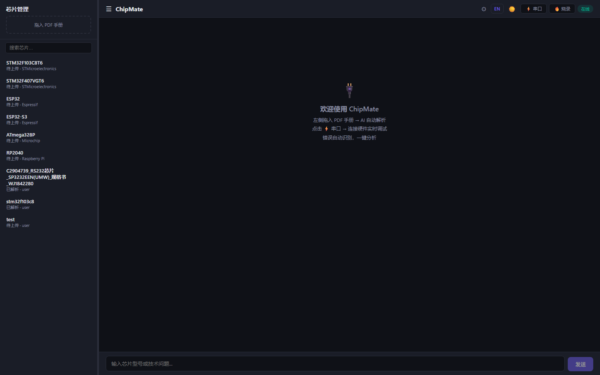
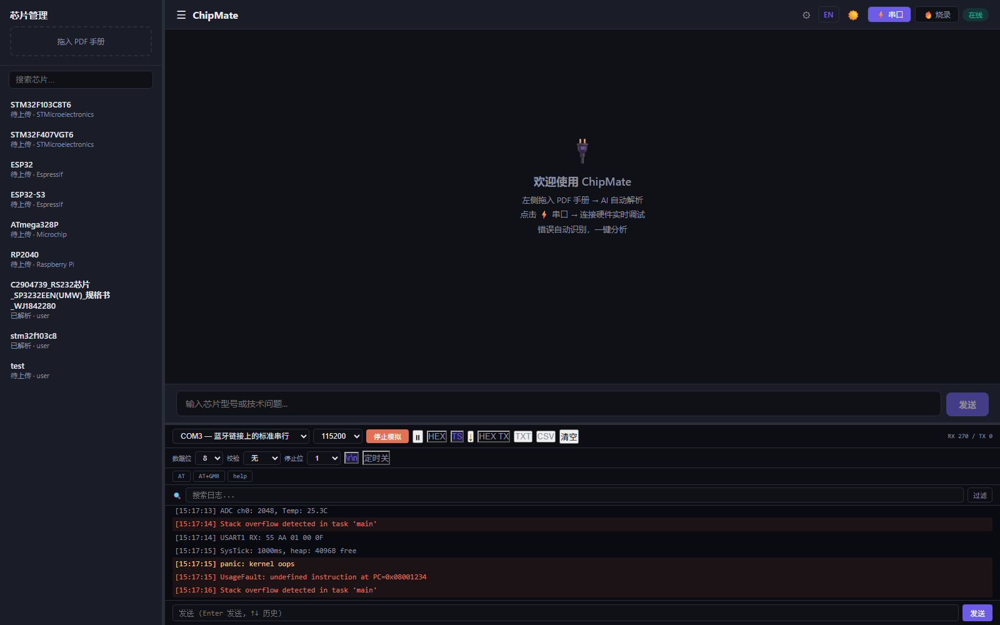
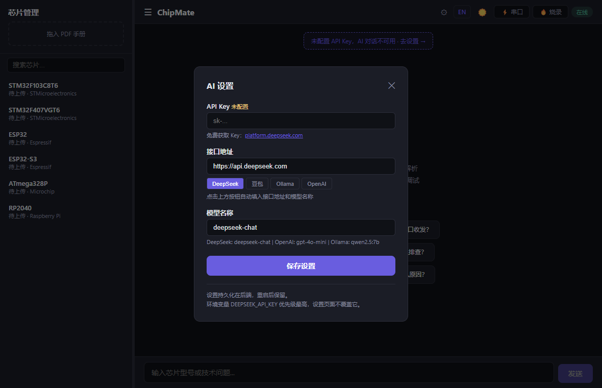

<div align="center">

# 🔌 ChipMate

**AI-powered Embedded Fault Diagnosis Workstation** — Plug in your serial port, let AI read what your chip is saying.

[English](README.md) | [简体中文](README_zh.md)

</div>

Connect your dev board, ChipMate automatically detects serial anomalies (HardFault / Watchdog / Stack Overflow...) and combines chip datasheet data for AI to give you troubleshooting steps and fixes. Supports **one-click STC MCU flashing**, and a **simulation mode** lets you experience everything without hardware.

> 🎯 Core loop: `Connect serial → Capture anomaly → Identify fault → Reference datasheet → AI analysis → Diagnosis report`

---

## ✨ Features

| Feature | Description |
|---------|-------------|
| 🩺 **AI Fault Diagnosis** | Auto-detects 10+ anomaly types (HardFault, BusFault, Watchdog, Timeout...), click an error line for one-click AI analysis |
| 📚 **Datasheet Context** | Drag in a PDF datasheet, AI answers reference specific pins and registers |
| 🔥 **One-click STC Flashing** | Load HEX file, pick chip model & port, cold-boot flash for STC 89/12/15/8 series |
| 🎮 **Simulation Mode** | No hardware needed — generated logs walk you through the full diagnosis loop |
| ⚡ **Streaming Output** | AI replies token-by-token, stoppable anytime |
| 🎨 **Multi-Model Support** | DeepSeek / OpenAI / Ollama / Doubao, configure API key in UI — no file editing |
| 🔍 **Log Search & Filter** | Keyword highlight / filter mode, TXT/CSV export |
| 🖱️ **Draggable Layout** | Resizable sidebar and panel heights |
| 🌗 **Dark / Light Themes** | One-click switch, preference saved |
| 📊 **Full Serial Params** | Data bits / stop bits / parity / timed send / RX-TX byte counters |

---

## 🖼️ Screenshots

| Main UI | Serial monitor & simulate mode |
|---|---|
|  |  |

| STC flashing | AI & model settings |
|---|---|
|  |  |

> Captured from the running v0.4.2 build; simulation mode needs no hardware.

---

## 🏗️ Architecture

```
┌─────────────────────────┐        ┌──────────────────────────┐
│   Electron + React UI   │  HTTP  │      Python FastAPI      │
│                         │ ─────► │                          │
│  ChatPanel  SerialPanel │        │  /chat      AI (stream)  │
│  ChipPanel  FlashPanel  │        │  /serial    Serial mgmt  │
│  Settings  Search/Filter│        │  /flash     STC flashing │
│                         │        │  /datasheet PDF parsing  │
└─────────────────────────┘        └──────────┬───────────────┘
                                              │
                                    ┌─────────┴─────────┐
                                    │ DeepSeek/OpenAI/  │
                                    │ Ollama/Doubao API │
                                    └───────────────────┘
```

---

## 🚀 Quick Start

### Requirements

- Python 3.10+ (dev mode only, not needed for packaged build)
- Node.js 18+ (dev mode only, not needed for packaged build)

### 💡 Windows One-Click Start (dev mode)

```bat
Double-click start.bat
```

The script:
1. Checks Python / Node.js (prompts with download links if missing)
2. Installs backend deps (`pip install`, 1-3 min first time)
3. Installs frontend deps (`npm install`, 5-15 min first time)
4. Starts backend (waits for health check)
5. Starts frontend and opens browser automatically

To stop: double-click `stop.bat`

### ❓ FAQ

**Q: "Python not found"?**
A: Install from [python.org](https://www.python.org/downloads/), **check "Add Python to PATH"** during install, then re-run start.bat.

**Q: "Node.js not found"?**
A: Install the LTS version from [nodejs.org](https://nodejs.org/), then re-run start.bat.

**Q: Dependency install failed / slow?**
A: Network issue — the script retries once. For slow npm, use a mirror:
```
npm config set registry https://registry.npmmirror.com
```

**Q: "Backend not ready in 30s"?**
A: Port 8720 is likely occupied. Close the conflicting program and retry, or check firewall settings.

**Q: Browser didn't open automatically?**
A: Manually visit http://127.0.0.1:5174

> 📌 Dependencies: backend pip deps ~200MB, frontend node_modules ~300MB (incl. Electron).
> A no-environment Windows installer is available: see [Releases](../../releases/latest) (v0.4.2, NSIS, unsigned).

### Manual Start

#### 1. Start backend

```bash
cd backend
pip install -r requirements.txt
pip install stcgal        # STC flashing tool (optional)
cp ../.env.example ../.env
python main.py            # runs at http://127.0.0.1:8720
```

#### 2. Start frontend

```bash
cd frontend
npm install
npm run dev               # runs at http://127.0.0.1:5174
```

#### 3. Configure AI

Click ⚙️ in the top-right:
- **DeepSeek** (recommended): register at [platform.deepseek.com](https://platform.deepseek.com) for free credits, paste your API key
- **Ollama local**: fully free, set base URL to `http://127.0.0.1:11434/v1`
- Or hit a preset button for Doubao / OpenAI

#### 4. Quick experience (no hardware)

1. Click **⚡ Serial** in the top bar
2. Click **Simulate** — generates realistic embedded logs
3. Click a red error line (e.g. HardFault) → AI analyzes it

#### 5. Flash an STC MCU

1. Click **🔥 Flash** in the top bar
2. Drag in your Keil-generated HEX file
3. Select chip model and port
4. Hit start, **power-cycle the MCU** (cold boot), wait for completion

---

## 🛠️ Tech Stack

- **Frontend**: Electron + React 18 + TypeScript + Vite
- **Backend**: Python FastAPI + pyserial
- **AI**: OpenAI SDK (compatible with DeepSeek / OpenAI / Ollama / Doubao)
- **Flashing**: stcgal (STC full-series ISP protocol)

---

## 🗺️ Roadmap

- [x] Streaming AI chat + multi-turn context
- [x] Serial fault detection + AI diagnosis loop
- [x] Simulation demo mode
- [x] STC MCU flashing
- [x] Serial search / filter / export
- [ ] Datasheet vector search (RAG with source page refs)
- [ ] Modbus protocol parsing
- [ ] Embedded calculators (baud / timer / CRC)
- [x] Windows installer release (v0.2.0, NSIS)

---

## 📄 License

[MIT](LICENSE)
