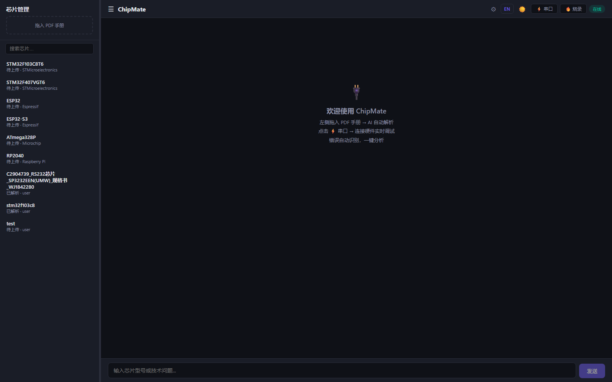
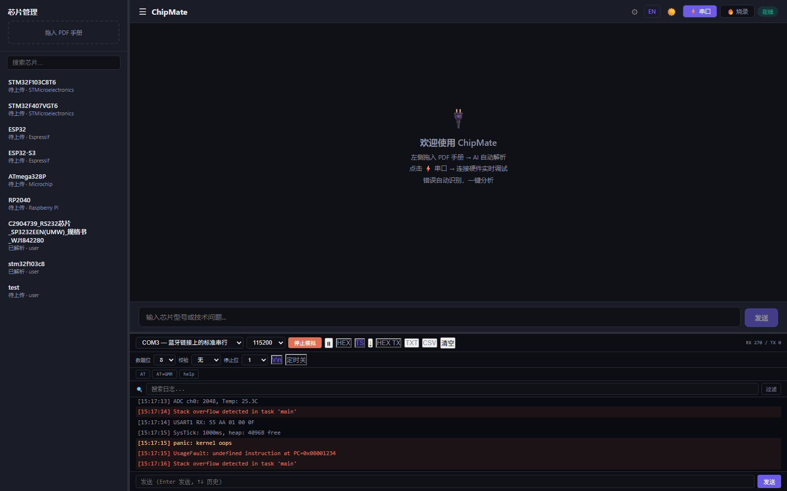
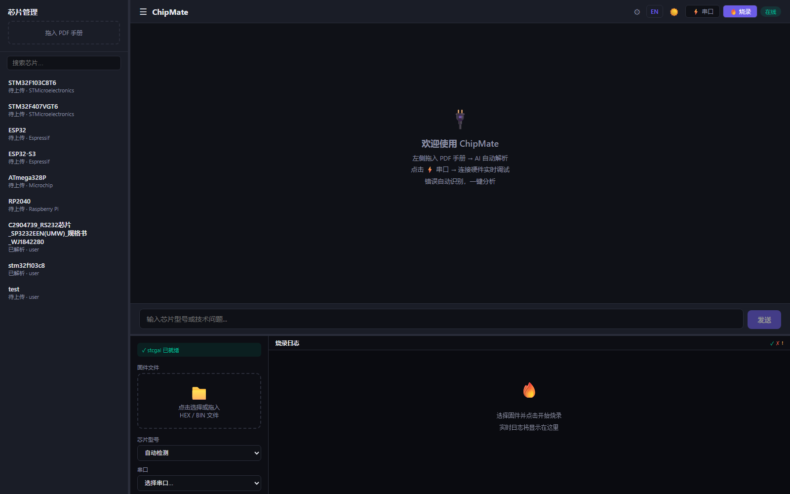
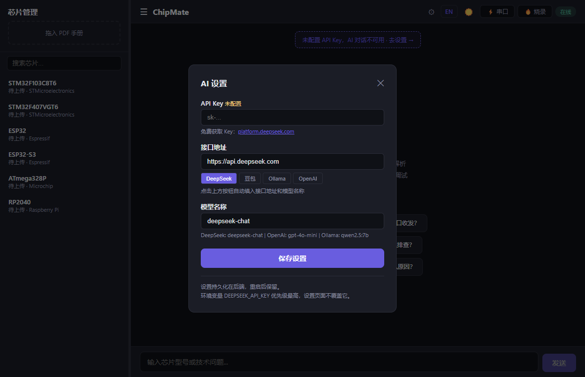

<div align="center">

# 🔌 ChipMate

**AI 驱动的嵌入式故障诊断工作站** — 连接串口，AI 帮你读懂芯片在说什么。

[English](README.md) | [简体中文](README_zh.md)

</div>

**AI 驱动的嵌入式故障诊断工作站** — 连接串口，AI 帮你读懂芯片在说什么。

接上开发板，ChipMate 自动识别串口异常（HardFault / Watchdog / Stack Overflow...），结合芯片手册数据，让 AI 给出排查步骤和修复建议。支持 **STC 单片机一键烧录**，无需硬件也能用**模拟模式**完整体验。

> 🎯 核心闭环：`连接串口 → 捕获异常 → 识别故障 → 结合芯片手册 → AI 分析 → 输出排查报告`

---

## ✨ 功能亮点

| 功能 | 说明 |
|------|------|
| 🩺 **AI 故障诊断** | 串口日志自动识别 HardFault、BusFault、Watchdog、Timeout 等 10+ 种异常，点击错误行一键 AI 分析 |
| 📚 **芯片手册上下文** | 拖入 PDF 数据手册，AI 回答引用具体引脚和寄存器 |
| 🔥 **STC 一键烧录** | 加载 HEX 文件，选择芯片型号和串口，冷启动即可烧录 STC 89/12/15/8 全系列 |
| 🎮 **模拟演示模式** | 无需硬件，生成模拟串口日志，完整体验故障识别 + AI 诊断闭环 |
| ⚡ **流式输出** | AI 回复逐字显示，支持随时停止 |
| 🎨 **多模型支持** | DeepSeek / OpenAI / Ollama / 豆包，界面直接配置 API Key，无需改文件 |
| 🔍 **日志搜索过滤** | 关键字高亮 / 过滤模式，支持 TXT/CSV 导出 |
| 🖱️ **可拖拽布局** | 侧栏宽度、面板高度自由调整 |
| 🌗 **深色/浅色主题** | 一键切换，自动保存偏好 |
| 📊 **完整串口参数** | 数据位 / 停止位 / 校验位 / 定时发送 / 收发字节计数 |
| 🔒 **本机访问令牌** | 写操作校验本机令牌，陌生网页无法调用你的接口、盗刷 API Key 额度 |

---

## 🖼️ 截图

| 主界面 | 串口监控与模拟模式 |
|---|---|
|  |  |

| STC 烧录 | AI 与模型设置 |
|---|---|
|  |  |

> 以上为 v0.4.0 实际运行界面，模拟模式无需连接硬件。

---

## 🏗️ 架构

```
┌─────────────────────────┐        ┌──────────────────────────┐
│   Electron + React UI   │  HTTP  │      Python FastAPI      │
│                         │ ─────► │                          │
│  ChatPanel  SerialPanel │        │  /chat     AI 对话(流式)  │
│  ChipPanel  FlashPanel  │        │  /serial   串口管理       │
│  Settings  搜索/过滤     │        │  /flash    STC 烧录       │
│                         │        │  /datasheet 芯片手册解析   │
└─────────────────────────┘        └──────────┬───────────────┘
                                              │
                                    ┌─────────┴─────────┐
                                    │ DeepSeek/OpenAI/  │
                                    │ Ollama/豆包  API   │
                                    └───────────────────┘
```

---

## 🚀 快速开始

### 环境要求

- Python 3.10+（仅开发模式需要，打包版不需要）
- Node.js 18+（仅开发模式需要，打包版不需要）

### 💡 Windows 一键启动（开发模式）

```bat
双击 start.bat
```

脚本自动完成：
1. 检查 Python / Node.js 是否安装（缺失会提示下载地址和注意事项）
2. 自动安装后端依赖（`pip install`，首次 1-3 分钟）
3. 自动安装前端依赖（`npm install`，首次 5-15 分钟）
4. 启动后端（等待健康检查通过）
5. 启动前端并自动打开浏览器

停止服务：双击 `stop.bat`

### ❓ 常见问题（FAQ）

**Q: 提示"未检测到 Python"？**
A: 去 [python.org](https://www.python.org/downloads/) 下载安装包，安装时**必须勾选 "Add Python to PATH"**，装完重新双击 start.bat。

**Q: 提示"未检测到 Node.js"？**
A: 去 [nodejs.org](https://nodejs.org/) 下载 LTS 版，一路下一步安装，装完重新双击 start.bat。

**Q: 依赖安装失败 / 下载很慢？**
A: 国内网络问题，重试一次即可（脚本会自动重试一次）。npm 慢可以配置国内镜像：
```
npm config set registry https://registry.npmmirror.com
```
pip 慢可以加镜像：把 start.bat 里的 `pip install` 改成 `pip install -i https://pypi.tuna.tsinghua.edu.cn/simple`。

**Q: 提示"后端 30 秒内未就绪"？**
A: 通常是 8720 端口被占用。关闭占用程序后重新启动，或检查防火墙是否拦截 Python。

**Q: 浏览器没自动打开？**
A: 手动访问 http://127.0.0.1:5174 即可。

> 📌 依赖大小说明：后端 pip 依赖约 200MB，前端 node_modules 约 300MB（含 Electron）。
> Windows 免环境安装包已发布：见 [Releases](../../releases/latest)（v0.4.0，NSIS，未签名）。

### 手动启动

#### 1. 启动后端

```bash
cd backend
pip install -r requirements.txt
pip install stcgal        # STC 烧录工具（可选）
cp ../.env.example ../.env
python main.py            # 启动在 http://127.0.0.1:8720
```

### 2. 启动前端

```bash
cd frontend
npm install
npm run dev               # 启动在 http://127.0.0.1:5174
```

### 3. 配置 AI

点击右上角 ⚙️ 设置：
- **DeepSeek**（推荐）：注册 [platform.deepseek.com](https://platform.deepseek.com) 送免费额度，填入 API Key
- **Ollama 本地**：完全免费，接口地址填 `http://127.0.0.1:11434/v1`
- 或点击预设按钮一键填入豆包 / OpenAI

### 4. 快速体验（无需硬件）

1. 点击顶部 **⚡ 串口** 打开串口面板
2. 点 **模拟** 按钮 —— 自动生成模拟嵌入式日志
3. 点击红色错误行（如 HardFault）→ AI 自动分析

### 5. 烧录 STC 单片机

1. 点击顶部 **🔥 烧录**
2. 拖入 Keil 生成的 HEX 文件
3. 选择芯片型号和串口
4. 点开始烧录，**给 MCU 断电再上电**，等待烧录完成

---

## 🛠️ 技术栈

- **前端**：Electron + React 18 + TypeScript + Vite
- **后端**：Python FastAPI + pyserial
- **AI**：OpenAI SDK（兼容 DeepSeek / OpenAI / Ollama / 豆包）
- **烧录**：stcgal（STC 全系列 ISP 协议）

---

## 🗺️ Roadmap

- [x] 流式 AI 对话 + 多轮上下文
- [x] 串口故障识别 + AI 诊断闭环
- [x] 模拟数据演示模式
- [x] STC 单片机烧录
- [x] 串口搜索 / 过滤 / 导出
- [ ] 芯片手册向量检索（RAG，带来源页码）
- [ ] Modbus 协议解析
- [ ] 嵌入式计算器（波特率 / 定时器 / CRC）
- [x] Windows 安装包发布（v0.2.0，NSIS）

---

## 📄 License

[MIT](LICENSE)
